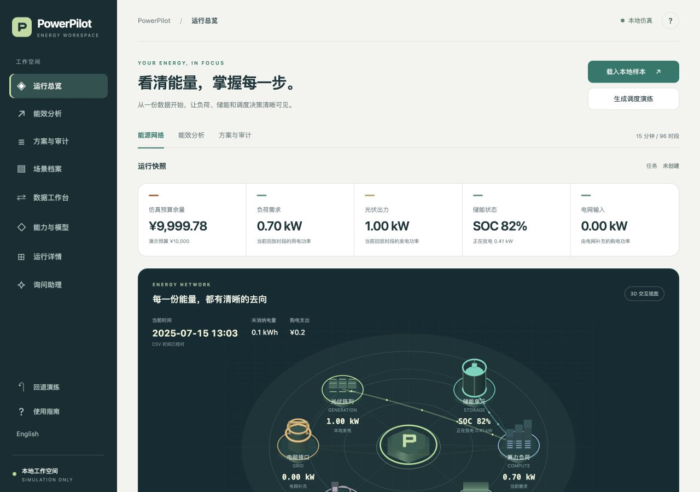

# PowerPilot

**看清能量，掌握每一步。**

PowerPilot 是用于园区能源分析与调度复核的本地工作台。载入一份用电数据，观察光伏、储能与购电的关系，在相同输入下比较方案，再通过独立审计和人工确认完成模拟执行。



## 启动工作台

安装 Conda 后，在项目目录执行：

```sh
make install
cp -n .env.example .env
make run
```

打开 <http://127.0.0.1:8000>。Python 和开发工具均运行在项目的 `.conda-env` 环境内。

## 从这里开始

1. **运行总览**：点击“载入本地样本”，查看能源网络。可平移、缩放或调整示意节点；视图操作不修改设备配置。
2. **能效分析**：查看同一回放日期的功率轨迹、累计用电和费用。内置样本来自 OpenCEM 公共测量数据，详情见 [数据说明](data/SOURCES.md)。
3. **方案与审计**：点击“生成调度演练”，检查候选方案和约束结论。批准方案 B 后才可模拟执行；该演练使用固定场景和候选数据，用于验证状态流转。
4. **场景档案**：查看当前回放记录，或打开内置演练。运行详情提供职责、权限和回执信息。
5. **能力与模型**：按角色配置自己的模型服务。模型对话和外部协作是可选能力，本地样本与调度演练无需模型密钥。

自有 CSV 可通过“数据工作台”上传。该适配器接受 OpenCEM 格式并聚合为 96 个时段；不符合格式的数据会被拒绝。默认不连接生产系统。

## 运行边界

PowerPilot 用于仿真与决策辅助，默认 `SIMULATION_MODE=true`、`ALLOW_PRODUCTION_WRITE=false`。数值优化、独立审计、人工审批和模拟执行各自承担明确职责。涉及柔性负荷的方案必须经人工确认；输入变化使旧审批失效，执行偏差超限触发保守回退。

本地验证不代表真实设备、生产数据库或外部协作服务已经接通。

## 开发入口

- [本地开发](DEVELOPMENT.md)：环境、目录、启动和构建。
- [实现结构](ARCHITECTURE.md)：数据、优化、审计和执行的边界。
- [验证状态](STATUS.md)：已完成检查及当前限制。
- 本地 API 文档：<http://127.0.0.1:8000/docs>；机器可读契约：`/openapi.json`。

```sh
make format
make verify
make build
```

## 许可

PowerPilot 使用 [GNU AGPL v3（仅第 3 版）](LICENSE)，SPDX 标识为 `AGPL-3.0-only`。
Copyright (C) 2026 Ustinian5。
随包资源的独立声明见 [第三方资源说明](THIRD_PARTY_NOTICES.md)。
